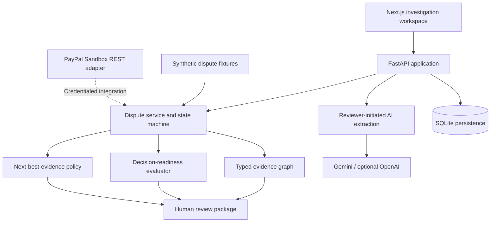

<div align="center">

# ProofGraph

### Evidence-first AI assistance for payment dispute investigations

**Turn conflicting claims into an auditable evidence graph. Identify what is missing. Ask for the next useful piece of evidence.**

[](#scope-and-safety) [](LICENSE) [](apps/web) [](apps/api)

[**Live demo**](https://proofgraph-83d9.onrender.com) · [**Run locally**](#run-the-project) · [**Workflow**](#how-proofgraph-works) · [**Architecture**](#architecture) · [**Safety**](#scope-and-safety) · [**Tests**](#testing-and-reproducibility)

</div>

---

> **PayPal AI Hackathon 2026 submission candidate.** ProofGraph is an independent prototype, not an official PayPal product. Showcased disputes are synthetic. The application does not autonomously adjudicate disputes, issue refunds, or move funds.

> **Try the public demo:** [proofgraph-83d9.onrender.com](https://proofgraph-83d9.onrender.com) — a synthetic, read-only showcase. The free hosting instance may take a minute to wake up after inactivity. Evidence submission and AI extraction require the interactive local version.

## The problem

A dispute is rarely a single missing document. Buyers, merchants, orders, tracking records, and supporting files may tell different stories. A fixed checklist can request unnecessary evidence while overlooking the contradiction that matters.

**ProofGraph turns a dispute into a structured investigation rather than a document collection exercise.** It preserves where assertions came from, distinguishes claims from independently verified observations, and recommends the next useful evidence request without hiding uncertainty.

## Product walkthrough

| Experience | What it demonstrates |
| --- | --- |
| **Case overview** | Dispute summary, available evidence, and recommended next step |
| **Evidence graph** | Typed entities and relationships with provenance and verification status |
| **Add evidence** | Submit tracking or a supporting file while preserving the previous evidence trail |
| **Contradiction analysis** | Surface conflicts such as order-destination versus reported-delivery mismatch |
| **AI-assisted extraction** | Reviewer-initiated, quote-grounded assertions labeled as unverified model inferences |
| **Review package** | Prepare an auditable dossier for human review; no automatic PayPal submission |

<!-- Add actual screenshots here after capture; do not use illustrative or fabricated UI images. -->
<!-- Add the public demo video URL after publication. -->

## How ProofGraph works

1. **Ingest the dispute.** Load a synthetic scenario or use the separate PayPal Sandbox adapter with appropriate credentials and permissions.
2. **Represent evidence.** Build a typed graph of orders, transactions, participants, claims, shipments, and observations.
3. **Preserve provenance.** User-entered tracking remains `USER_SUBMITTED / UNVERIFIED`; it does not become independent carrier proof by appearing in the graph.
4. **Identify gaps and contradictions.** Apply category-aware checks for Item Not Received, Significantly Not As Described, and Duplicate Charge.
5. **Recommend the next action.** A deterministic next-best-evidence policy selects a focused request or human escalation.
6. **Assist, don't adjudicate.** Optional Gemini extraction proposes source-grounded assertions but cannot override deterministic readiness.
7. **Prepare human review.** Generate a provenance-linked investigation report.

## Architecture



**Stack:** Next.js 15, React, React Flow, FastAPI, Pydantic, SQLAlchemy, NetworkX, SQLite, and optional Gemini/OpenAI APIs.

### PayPal integration: precise status

ProofGraph includes a PayPal Sandbox REST client for OAuth, dispute listing/details, and a provide-evidence API method. **The showcased end-to-end investigations use synthetic fixtures**, not live PayPal adjudication. Sandbox calls require separately configured credentials and permissions. No PayPal credentials are included.

The [PayPal capability audit](docs/paypal-capability-audit.md) and [Sandbox verification notes](docs/paypal-sandbox-verification.md) distinguish implemented client methods, documented endpoints, and independently verified live behavior.

## Run the project

### Full interactive local demo

Requirements: Python 3.12+, Node.js 20+, and Git. Open two terminals in the repository root.

**Terminal 1 — FastAPI**

```bash
python3 -m venv apps/api/.venv
apps/api/.venv/bin/python -m pip install -r apps/api/requirements.txt
PYTHONPATH="$PWD:$PWD/apps/api" apps/api/.venv/bin/python -m uvicorn app.main:app --app-dir apps/api --host 127.0.0.1 --port 8000
```

**Terminal 2 — Next.js**

```bash
cd apps/web
npm ci
npm run dev
```

Open **http://localhost:3000**. Next.js proxies `/api/v1/*` requests to the backend on port 8000.

Synthetic fixtures are used by default. Evidence changes persist to local SQLite; start with a fresh database for a clean judging run. Do not upload real customer data.

### Docker showcase (deployment branch)

A read-only Docker showcase has been tested locally on the separate `deploy/huggingface-space` development branch. **The Dockerfile is not yet committed to this branch**, so the following commands apply only after the deployment files are published:

```bash
docker build -t proofgraph-demo .
docker run --rm -p 7860:7860 proofgraph-demo
```

Open **http://localhost:7860**. The public-showcase configuration rejects state-changing requests; it is not the full interactive demo. Do not treat this as a production security boundary.

### Optional AI configuration

Set `GEMINI_API_KEY` in a local ignored `.env` or server-side process environment, **never in committed source or frontend configuration**. Extraction is reviewer-initiated. Missing credentials produce a fallback, not fabricated live AI output. See [AI configuration and privacy constraints](docs/issue18-real-ai-extraction.md).

## Suggested judging walkthrough

1. Open the **Keychron Item Not Received** synthetic case and inspect the recommendation.
2. Explore its evidence graph and distinguish buyer/seller claims from carrier-related observations.
3. Add a **synthetic tracking number**. Confirm the new shipment is **user-submitted and unverified**, with the original shipment preserved.
4. Open the **Sony Item Not Received** case for the delivery-destination contradiction and human-review escalation.
5. Explore a **SNAD** or **Duplicate Charge** case for category-specific evidence requirements.
6. Optionally run reviewer-initiated Gemini extraction with your own credentials; inspect exact source quotes and unverified AI provenance.
7. Open the review package. It is **prepared for human review**, not submitted to PayPal.

See the [full acceptance checklist](docs/final-local-acceptance.md).

## Testing and reproducibility

Backend, from the repository root after installing dependencies:

```bash
PYTHONPATH="$PWD:$PWD/apps/api" apps/api/.venv/bin/python -m pytest apps/api/tests -q
```

Frontend, from `apps/web`:

```bash
npm test
npm run build
npx playwright test --workers=1 --reporter=line
```

The prototype has passed local backend, frontend, browser, build, and Docker checks. **This does not claim hosted CI or public deployment success.** See [benchmark methodology](docs/benchmark-methodology.md) for synthetic evaluation design and limitations; fixture metrics are not real-world accuracy estimates.

## Scope and safety

- **Synthetic by default.** Demonstration cases are fixtures, not customer disputes.
- **No autonomous financial actions.** No refunds, money movement, or autonomous adjudication.
- **Provenance is explicit.** User submissions, model inferences, and simulated carrier telemetry must not be conflated with independent verification.
- **Human review remains authoritative.** Reports and recommendations support reviewers rather than replacing them.
- **Development authentication is not production identity.** The interactive demo uses a lightweight role model. Do not expose it publicly without proper authentication, tenant isolation, rate limiting, and storage controls.
- **Public read-only mode is limited.** The deployment prototype blocks non-read HTTP methods; that alone is not a complete security assessment.
- **Keep secrets and evidence private.** Never commit `.env` files, API keys, real customer information, or uploaded documents.

See the [security model](docs/security-model.md) and [project audit](docs/phase-2-audit.md).

## Repository guide

| Path | Purpose |
| --- | --- |
| [`apps/web`](apps/web) | Next.js dashboard and graph visualization |
| [`apps/api`](apps/api) | FastAPI routes, adapters, state machine, and investigation services |
| [`packages/shared_schemas`](packages/shared_schemas) | Typed domain models |
| [`fixtures`](fixtures) | Deterministic synthetic scenarios |
| [`benchmarks`](benchmarks) | Scenario-based policy evaluation |
| [`docs`](docs) | Architecture, audits, methodology, and security |

## Hackathon submission

Built for the [PayPal AI Hackathon 2026](https://paypalaihackathon.devpost.com/). The public video and any hosted demo links will be added after they are available.

**License:** [MIT](LICENSE).

---

<div align="center">

**ProofGraph** · Evidence first. Uncertainty visible. Humans in control.

</div>
