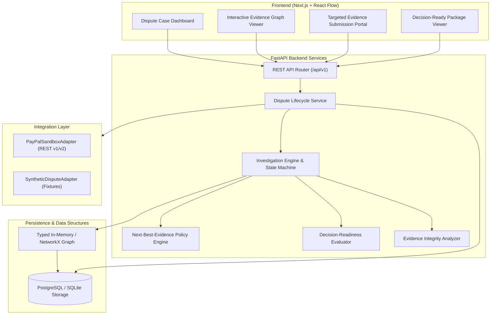
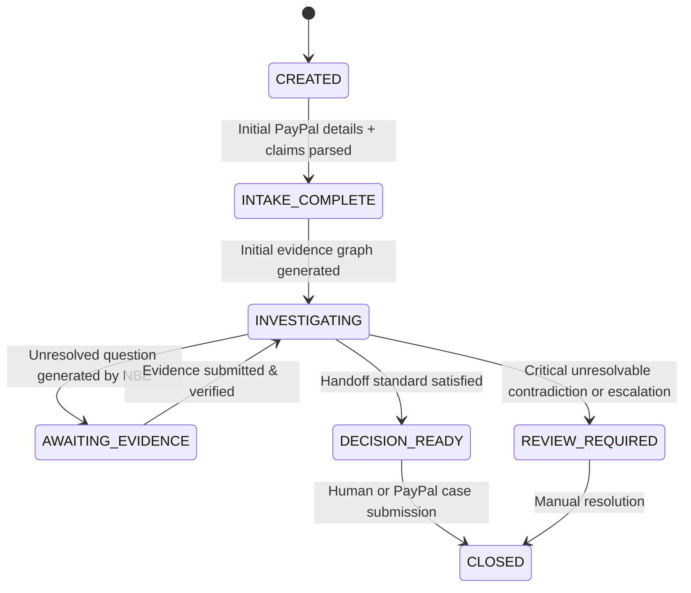

# System Architecture & Technical Specifications

**Project:** PayPal AI Dispute Investigator  
**Version:** 1.0.0  
**Status:** Implemented Base Architecture  

---

## 1. High-Level Architecture Overview

The system is structured as a decoupled monorepo composed of an asynchronous FastAPI backend, a Next.js 15 client dashboard with interactive React Flow graph visualization, and an isolated evidence-graph engine.



---

## 2. Investigation State Machine

The dispute lifecycle is governed by an explicit deterministic state machine. State transitions are strictly validated in Python code and cannot be bypassed by LLM prompts.



### Valid Transitions Table
| Source State | Target State | Trigger / Guard Condition |
| :--- | :--- | :--- |
| `CREATED` | `INTAKE_COMPLETE` | Dispute metadata ingested, initial party claims registered. |
| `INTAKE_COMPLETE` | `INVESTIGATING` | Initial graph nodes constructed; baseline evaluation performed. |
| `INVESTIGATING` | `AWAITING_EVIDENCE` | Open questions exist with candidate acquisition action selected. |
| `AWAITING_EVIDENCE` | `INVESTIGATING` | Response received; evidence node & observation nodes added to graph. |
| `INVESTIGATING` | `DECISION_READY` | Deterministic category readiness rules satisfied (e.g. valid delivery proof or unequivocal proof of refund). |
| `INVESTIGATING` | `REVIEW_REQUIRED` | Fraud alert triggered, counterparty deadlocked, or timeout reached without required evidence. |
| `DECISION_READY` | `CLOSED` | Human adjudicator signs off and exports/submits package to PayPal. |

---

## 3. Typed Evidence Graph Specification

The evidence graph provides complete provenance and traceability for every dispute finding.

### Node Types
- `DISPUTE`: The root dispute object containing case IDs, amount, and category.
- `CLAIM`: A factual assertion made by either buyer or seller (e.g., "Item was never delivered to my address").
- `TRANSACTION`: PayPal transaction ID, timestamp, currency, payer/payee IDs.
- `ORDER`: Merchant order representation, sku lines, billing/shipping address.
- `SHIPMENT`: Carrier name, tracking number, ship timestamp, destination.
- `EVIDENCE_ITEM`: An ingested artifact (document, image, carrier scan API payload, email transcript).
- `OBSERVATION`: A verified or extracted atomic fact derived from evidence (e.g. "Carrier status is DELIVERED to ZIP 94107 on 2026-10-04").
- `QUESTION`: An unresolved factual question requiring answer.
- `HYPOTHESIS`: An explanatory candidate (e.g. "Package stolen post-delivery", "Sent to outdated address").
- `SOURCE`: Provenance authority (PayPal API, Merchant ERP, Carrier API, Buyer Upload).

### Edge Types
- `SUPPORTS`: Source node provides positive factual corroboration for target claim/hypothesis.
- `CONTRADICTS`: Source node conflicts with target claim (e.g. Delivery ZIP 94107 contradicts Buyer Address ZIP 97201).
- `DERIVED_FROM`: Observation extracted directly from an Evidence Item.
- `RELATES_TO`: Associative connection (e.g. Claim relates to Order).
- `REQUIRES_VERIFICATION`: A claim or observation that lacks corroborating proof.
- `ANSWERS`: An evidence item or observation that resolves a Question.
- `REFERENCES`: Transaction references Order.

---

## 4. Next-Best-Evidence (NBE) Selection Policy

Rather than generic questioning, the engine prioritizes actions using an interpretable heuristic utility function:

$$\text{Score}(a) = \frac{w_r \cdot \text{Relevance}(a) + w_u \cdot \text{UncertaintyReduction}(a) + w_c \cdot \text{ContradictionWeight}(a)}{1.0 + \text{Friction}(a)}$$

Where:
- $\text{Relevance}(a) \in [0, 1]$: Proximity in graph to unverified core claims.
- $\text{UncertaintyReduction}(a) \in [0, 1]$: Estimated drop in missing requirements.
- $\text{ContradictionWeight}(a) \in [0, 1]$: Ability to resolve an active `CONTRADICTS` edge.
- $\text{Friction}(a) \in [0, 2]$: Operational cost (0 for automated API lookup, 0.5 for internal merchant lookup, 1.5 for buyer outreach).

The policy engine exposes a clean interface:
```python
class NextBestEvidencePolicy(ABC):
    @abstractmethod
    def select_action(
        self, graph: EvidenceGraph, dispute: DisputeCase
    ) -> PolicyDecision:
        ...
```
Supported implementations:
1. `HeuristicNBEPolicy`: Deterministic, zero-cost, reproducible algorithm.
2. `LLMAssistedNBEPolicy`: Model-augmented candidate generator with schema validation.

---

## 5. Decision-Readiness Evaluator

Evaluates whether a case package is ready for human adjudication according to explicit category policies:

### Category: `ITEM_NOT_RECEIVED` (INR)
- **Minimum Requirements for Decision-Readiness:**
  1. Transaction record verified.
  2. Carrier tracking number present and verified with carrier telemetry.
  3. Delivery destination address verified against PayPal checkout shipping address.
  4. Delivery timestamp verified relative to order date.
  5. Buyer claim acknowledged and checked for address match.
- If requirements met $\rightarrow$ `DECISION_READY`.
- If tracking shows delivered to a different postal code $\rightarrow$ `REVIEW_REQUIRED` (Factual Discrepancy Flagged).
- If carrier confirms lost in transit $\rightarrow$ `DECISION_READY` (Lost in Transit Verified).

---

## 6. Image & Document Integrity Analyzer

Located in `apps/api/app/services/image_integrity.py`:
- Calculates cryptographic hashes (`SHA-256`, `MD5`) for tamper audit trails and deduplication.
- Extracts EXIF metadata (Camera make/model, original software, creation timestamps, GPS data).
- Detects format anomalies (mismatched MIME type vs extension).
- Flags AI-synthesis or digital manipulation artifacts as probabilistic indicators:
  - Returns `confidence: float`, `status: INCONCLUSIVE | SUSPICIOUS | CONSISTENT`.
  - Enforces product rule: **AI-detection is never proof of fraud.**
